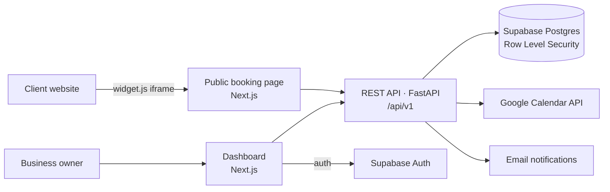

# Horum — White-Label Booking SaaS

**Multi-tenant appointment scheduling platform: each business gets its own branches, staff, services and a public booking page that can be embedded on any website with one `<script>` tag.**


> 🇪🇸 SaaS de agendamiento de citas marca blanca (multi-negocio), con Next.js 14, FastAPI y Supabase.

## Architecture



| Layer | What's there |
|---|---|
| **Backend** (`src/backend`) | FastAPI app with versioned routers: `auth`, `businesses`, `branches`, `staff`, `services`, `appointments`, `calendar`. Slot-availability algorithm with overlap detection (`core/availability.py`), JWT + bcrypt (`core/security.py`), Google Calendar client, email notifications. |
| **Frontend** (`src/frontend`) | Next.js 14 App Router with route groups: `(auth)` login/register, `(dashboard)/[business_slug]` for owners (branches, staff), `(public)/booking/[branch_id]` for end customers. |
| **Embeddable widget** | [`public/widget.js`](./src/frontend/public/widget.js) — drop `<script src=".../widget.js" data-branch-id="...">` into any site to render the booking flow. |
| **Database** | [`supabase/migrations/001_initial_schema.sql`](./supabase/migrations/001_initial_schema.sql): businesses, branches, staff, specialties, services, appointments and Google Calendar sync, with **Row Level Security** enabled for tenant isolation. |

## Quick start

### 1. Database
Create a [Supabase](https://supabase.com) project and run `supabase/migrations/001_initial_schema.sql` in the SQL editor.

### 2. Backend
```bash
cd src/backend
python -m venv venv && source venv/bin/activate   # Windows: venv\Scripts\activate
pip install -r requirements.txt
cp ../../.env.example .env
uvicorn app.main:app --reload    # docs at http://localhost:8000/docs
```

### 3. Frontend
```bash
cd src/frontend
npm install
cp ../../.env.example .env.local
npm run dev                      # http://localhost:3000
```

### Or everything with Docker
```bash
cp .env.example .env
docker compose up --build
```

## Roadmap

- [ ] Automated tests for the availability algorithm and appointment endpoints (pytest)
- [ ] Full booking flow UI + payment integration
- [ ] CI pipeline (lint + tests) with GitHub Actions

## Author

**Jhoe Miranda** — co-founder at Horum Labs · [GitHub](https://github.com/yoesitooo) · [LinkedIn](https://www.linkedin.com/in/jhoe-miranda)
